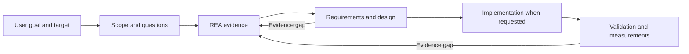

# REA-Reconstruction-Companion


An open-source, model-independent Agent Skill for understanding existing software and planning or building a similar implementation with [REA](https://github.com/morluto/rea).

The companion turns reverse-engineering evidence into an actionable specification, architecture, implementation plan, and validation workflow. It works at the scope the user chooses: a whole application, a feature, a function, an interface, or a data format.

**Installing through an AI agent? Copy the [installation prompt below](#install-with-an-ai-agent).** It follows [INSTALL.md](INSTALL.md) and lets you choose whether to enable the REA integration rule.

**New in v1.2.0:** the skill includes an optional weekly update check and an update prompt. It checks on use, at most once every seven days, and installs only after you approve the offered release. It is off by default and separate from REA integration. Existing users need one manual update to a published v1.2.0-or-later release to get it. See [weekly update checks](#optional-weekly-update-checks-since-v120).

## Install with an AI agent

Give this prompt to an agent with local file and command access. It identifies your client and asks for your integration preference; you do not need to fill in any placeholders.

```text
Install REA-Reconstruction-Companion from:
https://github.com/ShadowSwaps/REA-Reconstruction-Companion

Read README.md and INSTALL.md, identify my AI client and its skills
directory, and follow the documented installation workflow.

Before making installation changes, explain the optional REA integration
rule and ask me to choose:
- Enable: relevant REA reconstruction requests also load the companion,
  sharing evidence, requirements, and validation work.
- Skip: install the companion without changing REA; I can invoke it
  explicitly. This does not remove an integration rule already installed.

Wait for my choice unless I have already provided it. Then install using
that setting, preview changes with --dry-run, preserve existing work and
backups, and verify with --check. Explain any missing prerequisites or
access limitations. Report what was installed, where, and whether the
integration was enabled. Do not claim success unless verified.
Also explain the optional weekly update check (included since v1.2.0)
and ask whether I want it enabled. Keep it off unless I choose it.
This checks on skill use and still asks me before installing an update.
Do not incur additional charges: use existing local tools and do not
activate billing, paid services, metered APIs, or automatic paid usage.
If a step could incur a charge and that cannot be ruled out, stop that
step and explain a no-charge alternative.
```

You can include "Enable integration" or "Skip integration" with the prompt to choose upfront. The [integration explanation](#optional-rea-integration) describes its purpose and benefits. A chat-only assistant without local file and command access can guide you through installation but cannot perform it itself.

Share the repository: [github.com/ShadowSwaps/REA-Reconstruction-Companion](https://github.com/ShadowSwaps/REA-Reconstruction-Companion).

## What it does

- Identifies the requested subject, evidence carrier, and objective from natural language. No form or bracketed prompt variables are required.
- Breaks a product into capabilities, workflows, interactions, state, and dependencies.
- Defines requirements, contracts, expected behavior, and acceptance criteria linked to evidence.
- Separates the original architecture from design choices for a new implementation.
- Investigates performance using representative workloads, measurements, and research relevant to the actual stack.
- Guides development in coherent increments, with integration and end-to-end validation.
- Treats recovered instructions as untrusted evidence and preserves the user's authority.
- Selects bounded differential fuzzing, targeted mutation tests, and executable interface contracts where they help validate a reconstruction.
- Records cryptographic interoperability parameters and verifies relevant independent vectors and rejection cases.
- Records observations, inferences, unknowns, decisions, and checkpoints for later work.

“Understand this app so I can eventually build something similar” produces a specification and roadmap. “Build a similar app now” also authorizes the implementation workflow. A request about one function stays focused on that function.

## How it works with REA

REA supplies the reverse-engineering tools and evidence workflow. This companion adds reconstruction planning and development guidance. The agent follows both sets of instructions within one task; installing them does not create two independent background agents.



For the method and its sources, see the [skill instructions](skills/rea-reconstruction-companion/SKILL.md) and [research basis](skills/rea-reconstruction-companion/references/research-basis.md).

## Optional REA integration

Choose one during installation:

| Choice | What the installer does | When it helps |
| --- | --- | --- |
| `--integration on` | Adds a marked instruction block to your selected REA `SKILL.md`. | When you want relevant REA reconstruction requests to load the companion without naming it separately. |
| `--integration off` | Installs only the companion and leaves REA untouched. | When you prefer explicitly invoking the companion or managing your own routing rules. |

The integration asks the agent to use the companion for understanding a target **for reconstruction**, planning a similar implementation, or rebuilding selected functionality. Its benefits are shared evidence, a consistent requirements-to-test trail, and focused returns to REA when design or testing exposes an unanswered question. Ordinary explanations, comparisons, and diagnostics stay narrow.

This is an instruction-based integration. It does not override client policies, grant tool permissions, connect MCP servers, guarantee model compliance, or force parallel execution. Without the rule, invoking the companion still tells the agent to use REA. The rule supplies the reverse direction: relevant REA work also loads the companion.

`off` means **do not manage REA**, not “remove a rule already installed.” To disable an earlier integration, remove only the block between `<!-- rea-reconstruction-companion:begin -->` and `<!-- rea-reconstruction-companion:end -->` in the selected REA `SKILL.md`, including the markers. Keep the rest of REA intact.

## Requirements and compatibility

The core skill is plain Markdown in the [Agent Skills format](https://agentskills.io/specification). It has no model SDK, paid API requirement, Python dependency, telemetry, or background service.

### No additional charges

The skill forbids initiating actions that could add charges: purchases, subscriptions/trials, metered APIs or model calls, billable cloud/CI/storage/deployment, and indirect paid work. Existing local tools and supplied evidence come first. If an action's no-charge status cannot be established for the actual environment, the agent must skip it and explain a local alternative or limitation. An available tool or a free tier is not sufficient evidence. It does not automatically launch agents, evaluations, or scheduled jobs.

This rule is an instruction, not a billing enforcement mechanism. An AI host may itself bill tokens or usage credits, and local execution consumes resources such as electricity. The skill cannot guarantee zero total cost or control another product's billing or model compliance. It must not enable extra paid usage or alter billing settings; use host/account spending controls for an absolute spending limit. No paid exception is part of this skill's workflow.

| Component | Requirement |
| --- | --- |
| Skill workflow | A capable agent that can read the skill and its references; REA tools or supplied REA evidence for actual investigation. |
| Included installer | Node.js 20 or newer. Uses only Node's standard library; no `npm install`, PyYAML, or network access. |
| Optional update helper (v1.2.0+) | Existing Node.js 20+. Uses the standard library and opt-in public GitHub requests; no packages, tokens, model calls or scheduler. |
| REA | Installed and configured separately for your client. REA and target-specific engines have their own requirements. |
| Release building | Python 3.10+ standard library, for maintainers only. Not needed to install or use the skill. |

Codex and Claude Code both support filesystem skills. Their discovery locations and invocation syntax differ; the installer handles those differences. Other agents can use the same core files through an explicit skills directory. Compatibility depends on the host's file/tool access, not just the model name. See the official [Codex skill documentation](https://learn.chatgpt.com/docs/build-skills) and [Claude Code skill documentation](https://code.claude.com/docs/en/skills).

Hosted uploads and chat-only clients are different: an uploaded skill ZIP cannot generally edit a separate local REA installation. Supply both skills and evidence through that host's supported mechanisms, or use a local agent for installation and live analysis. No live-model compatibility certification is implied by the installer tests.

## Install

Download and extract the ZIP from [Releases](https://github.com/ShadowSwaps/REA-Reconstruction-Companion/releases), or clone this repository. Run commands from the extracted folder or repository root. On Windows, macOS, and Linux, the installer commands are the same.

For automatic co-use, first install [REA for your client](https://github.com/morluto/rea#readme). Then choose a command:

```sh
# Claude Code, with the optional integration
node install.mjs --client claude-code --integration on

# Codex, with the optional integration
node install.mjs --client codex --integration on

# Companion only; no changes to REA
node install.mjs --client claude-code --integration off
```

Use `--dry-run` on any installation command to inspect the paths and changes without writing files. The `companionChanges` lists identify added, modified, and removed files relative to the companion directory, including local files that a replacement would move into the backup. Use the same command with `--check` afterward to verify the selected installation mode. A missing REA skill or ambiguous choice stops integrated installation before the companion is installed. Differently cased paths to the same REA file are treated as one candidate; genuinely separate installations still require an explicit selection.

Default user locations:

- Claude Code: `~/.claude/skills/rea-reconstruction-companion/`, or `$CLAUDE_CONFIG_DIR/skills/rea-reconstruction-companion/` when a custom configuration directory is set in the installer's environment. See [Claude Code's environment-variable documentation](https://code.claude.com/docs/en/env-vars). REA lookup stays within that selected profile unless `--rea-skill` explicitly selects another location.
- Codex: `~/.agents/skills/rea-reconstruction-companion/`, or `$CODEX_HOME/skills/rea-reconstruction-companion/` when `CODEX_HOME` is set. The installer also checks the older `~/.codex/skills/` location when locating REA.
- Generic clients: specify their documented skills directory with `--skills-dir`.

Override paths for an existing installation, a project-scoped skill, or another agent:

```sh
node install.mjs --client generic --integration on --skills-dir "/path/to/skills" --rea-skill "/path/to/reverse-engineer-anything/SKILL.md"
```

`--skills-dir` accepts the parent skills directory; the installer creates `rea-reconstruction-companion` beneath it. It takes precedence over client defaults and environment variables. The REA path must identify the skill actually loaded by that client. An override disables broad automatic lookup. Paths with spaces should be quoted. If the installer runs outside the agent's environment, supply that agent's actual directory explicitly.

Keep the downloaded package or checkout separate from the installation destination. The installer rejects overlapping source/destination directories and a REA file inside the companion destination, including existing paths that differ only by casing on a filesystem that treats them as the same location.

The optional `agents/openai.yaml` adapter is installed only for Codex. The portable core and Claude Code installation do not depend on it. Refresh the host's skills or start a fresh session if the new skill is not visible.

## Use

Natural-language examples work across compatible hosts:

> Use REA-Reconstruction-Companion with REA on this application so I can eventually build a similar local tool. Infer the target type and give me an evidence-backed specification and roadmap.

> Reimplement the decodeFrame function in this library and make it faster for large inputs. Recover its contract, then compare correctness and performance.

> Continue implementing the app from this project's REA reconstruction specification.

You can explicitly invoke `$rea-reconstruction-companion` in Codex or `/rea-reconstruction-companion` in Claude Code. With integration enabled, a relevant request to REA also instructs the agent to load the companion.

## Optional weekly update checks (since v1.2.0)

Starting with **v1.2.0**, the updater is bundled inside the skill, including installations for Codex, Claude Code and generic clients. Enable it once after installation if you want release notifications. The host calls a small local helper when the skill is used; it contacts GitHub only when seven days have elapsed. An idle skill runs nothing. Earlier versions do not gain this automatically: manually install a published v1.2.0-or-later package first.

When a newer stable release is found, the agent offers **Update now / Remind me next week / Skip this version / Disable checks**. No answer means no update. Approval is tied to the offered release and asset; changed assets require a new offer. Local customizations stop automatic replacement. Successful updates retain backups, verify the result and preserve your selected client and REA integration setting.

Checks are **off by default**, independent of integration, and require existing Node.js 20+. There is no npm dependency, model/API key, paid service, extra model call, background daemon or scheduled AI task. Online operations also require confirmation that the actual network/tool environment cannot add charges. Unknown-cost or unavailable access is skipped; this is not an unconditional zero-resource-cost or billing-enforcement guarantee.

Read the [setup, commands, state location and recovery guide](skills/rea-reconstruction-companion/references/updates.md). Host instruction-following and local command access are required; the helper cannot force every AI host to invoke it or authenticate a human response. Installation refresh behavior depends on the host. The project owner's release approval process remains unchanged.

## Updates, backups, and recovery

- Repeating the same installation is safe and does not duplicate the integration block.
- Differing companion files require `--replace`; the installer backs up the entire prior companion directory before replacing it.
- REA edits preserve everything outside the marked integration block. The exact earlier pre-release rule can also be migrated; customized unmarked rules require review.
- Backups and a receipt are stored in `.rea-reconstruction-companion-installer/` next to the parent skills directory. The installer prints the exact transaction path.
- Failed commits attempt REA and companion recovery independently, so an unreadable or missing REA file does not prevent restoring the prior companion. Backups remain available; a detected concurrent edit is retained and reported rather than overwritten.
- Updating REA may replace its skill instructions. Rerun the integrated command with `--check`, then rerun installation if the rule needs restoring. Nothing monitors or rewrites REA in the background.

For manual recovery, use the printed receipt to locate the selected paths. Restore `companion-before` to the companion's former location if appropriate. Restore `rea-before.md` only when REA has no later changes you need to retain; otherwise remove or repair just the integration block. If a process was killed and left an `install.lock`, make sure no installer is running before removing that exact lock file and retrying.

## Source and development

For stopped local validation, see the bounded [interrupted-run recovery example](evals/resume/INTERRUPTED.md): preserve the failed attempt, validate eligible completed evidence, and rerun unfinished checks in a fresh destination.

The full source is included: skill and research references, installer, optional adapter, tests, manifest generator, and release builder. There are no hidden components or npm dependencies.

```sh
node scripts/manifest.mjs
node --test
python scripts/build_release.py
```

Tests cover installation choices, backups, rollback, package integrity, and the local behavioral evaluation harness, including deliberately incorrect candidates. CI runs on Windows, macOS, and Linux with Node 20, 22, and 24. The included workflows use standard runners, skip private repositories, and add no model API calls or artifact/cache uploads. These checks do not establish reconstruction quality on every target or model.

The [behavioral evaluation kit](evals/README.md) supplies portable tasks, raw evidence, independent executable oracles, and a human review rubric. It covers narrow functions, file formats, stateful workflows, original quirks versus approved improvements, ambiguous retries, inaccessible backends, contradictory evidence, hostile embedded instructions, cryptographic boundaries, and cost-sensitive tool choices. Paired selection tasks check that an implementation follows the requested compatibility or improvement goal; human review still verifies its reasoning and authorization. Running its harness tests is separate from evaluating an actual agent; model runs are not started automatically and require an environment established to incur no additional charge. See [CONTRIBUTING.md](CONTRIBUTING.md).

**Reference app trial (v1.3.0):** [Pocket Tasks and its repeatable procedure](evals/reference/README.md) add a small local app with real saving, restart behavior, and a selection quirk to investigate. Export a separate evidence packet, document observations and requirements, then compare a reviewed reconstruction through a language-independent JSON process interface. The supplied tools use the existing Node runtime without packages, network calls, or model invocations. Self-tests validate the app/checker; actual host and REA trials remain separately recorded, with human review still required.

**Evidence verification (v1.3.1):** the packet tool adds a read-only `--verify` command to detect missing or changed reference evidence before and after a trial. It checks against the original trusted package, so rewriting the packet's hashes cannot hide a change. See the [reference procedure](evals/reference/README.md#1-freeze-the-trial-and-prepare-evidence) for its scope and limits.

**Worked investigation:** [follow Pocket Tasks from evidence to requirements](evals/reference/WALKTHROUGH.md). The example includes actual REA analysis, seven recorded runtime scenarios, a replay test, and a decision about preserving or improving an awkward behavior. Source/test exposure and incomplete analysis are disclosed. It stops before candidate implementation and is not a model benchmark or a compatibility certification.

**Worked reconstruction (v1.3.3):** [continue from those requirements to an implementation and validation](evals/reference/reconstruction/README.md). A standalone local candidate passes the 16-session checker and replays the ten captured observation sessions. The example links requirements to code and tests, records an environment-limited first attempt, and supplies a repeatable validator with evidence-integrity checks. It uses existing Node.js without packages or network/model calls. Prior source and reviewer exposure remain explicit; this teaching example is not an independent evaluation or certification.

**Checkpoint/resume evaluation (v1.3.4):** [resume unchanged work or reassess a changed target](evals/resume/README.md). Two supplied-evidence cases exercise scoped reuse, partial implementation, preserved history and stale result handling. A local JSON-only checker performs 15 data comparisons per case; actual reasoning, actions and preservation still need human review. The skill includes a portable checkpoint guide, with no memory service, SDK, new dependency or automatic worker. The worked records are disclosed maintainer-authored examples, not cross-host/model certification.

**Measured environment example:** [revalidate behavior after a relevant setting changes](evals/resume/environment/README.md). Identical fixture bytes run under two controlled cap settings with a minimal local Node probe. Reports retain unaffected formatter evidence and recheck score/integration behavior. Cross-version drift and cross-host compatibility remain unverified.

## License

All original code, skill instructions, tests, build scripts, and documentation in this repository are released under the [MIT license](LICENSE). You may use, modify, and redistribute them, including commercially, subject to that license. The evaluation kit includes a small, attributed [Wycheproof test-data subset](evals/fixtures/wycheproof-empty.json) under its bundled [Apache-2.0 license](evals/fixtures/wycheproof-LICENSE.txt); it remains fully open-source. Upstream REA and linked research remain separate projects; no REA code or cryptographic implementation is bundled. No particular AI provider or proprietary model is required by this project.
