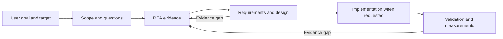

# REA-Reconstruction-Companion

An open-source, model-independent Agent Skill for understanding existing software and planning or building a similar implementation with [REA](https://github.com/morluto/rea).

The companion turns reverse-engineering evidence into an actionable specification, architecture, implementation plan, and validation workflow. It works at the scope the user chooses: a whole application, a feature, a function, an interface, or a data format.

**Installing through an AI agent? Give it this repository link and ask it to follow [INSTALL.md](INSTALL.md).** Installation offers an explicit choice to enable or skip the REA integration rule.

## What it does

- Identifies the requested subject, evidence carrier, and objective from natural language. No form or bracketed prompt variables are required.
- Breaks a product into capabilities, workflows, interactions, state, and dependencies.
- Defines requirements, contracts, expected behavior, and acceptance criteria linked to evidence.
- Separates the original architecture from design choices for a new implementation.
- Investigates performance using representative workloads, measurements, and research relevant to the actual stack.
- Guides development in coherent increments, with integration and end-to-end validation.
- Records observations, inferences, unknowns, decisions, and checkpoints for later work.

“Understand this app so I can eventually build something similar” produces a specification and roadmap. “Build a similar app now” also authorizes the implementation workflow. A request about one function stays focused on that function.

## How it works with REA

REA supplies the reverse-engineering tools and evidence workflow. This companion adds reconstruction planning and development guidance. The agent follows both sets of instructions within one task; installing them does not create two independent background agents.



For the method and its sources, see the [skill instructions](skills/rea-reconstruction-companion/SKILL.md) and [research basis](skills/rea-reconstruction-companion/references/research-basis.md).

## Optional REA integration

Choose one during installation:

| Choice | What the installer does | When it helps |
| --- | --- | --- |
| `--integration on` | Adds a marked instruction block to your selected REA `SKILL.md`. | When you want relevant REA reconstruction requests to load the companion without naming it separately. |
| `--integration off` | Installs only the companion and leaves REA untouched. | When you prefer explicitly invoking the companion or managing your own routing rules. |

The integration asks the agent to use the companion for understanding a target **for reconstruction**, planning a similar implementation, or rebuilding selected functionality. Its benefits are shared evidence, a consistent requirements-to-test trail, and focused returns to REA when design or testing exposes an unanswered question. Ordinary explanations, comparisons, and diagnostics stay narrow.

This is an instruction-based integration. It does not override client policies, grant tool permissions, connect MCP servers, guarantee model compliance, or force parallel execution. Without the rule, invoking the companion still tells the agent to use REA. The rule supplies the reverse direction: relevant REA work also loads the companion.

`off` means **do not manage REA**, not “remove a rule already installed.” To disable an earlier integration, remove only the block between `<!-- rea-reconstruction-companion:begin -->` and `<!-- rea-reconstruction-companion:end -->` in the selected REA `SKILL.md`, including the markers. Keep the rest of REA intact.

## Requirements and compatibility

The core skill is plain Markdown in the [Agent Skills format](https://agentskills.io/specification). It has no model SDK, paid API requirement, Python dependency, telemetry, or background service.

| Component | Requirement |
| --- | --- |
| Skill workflow | A capable agent that can read the skill and its references; REA tools or supplied REA evidence for actual investigation. |
| Included installer | Node.js 20 or newer. Uses only Node's standard library; no `npm install`, PyYAML, or network access. |
| REA | Installed and configured separately for your client. REA and target-specific engines have their own requirements. |
| Release building | Python 3.10+ standard library, for maintainers only. Not needed to install or use the skill. |

Codex and Claude Code both support filesystem skills. Their discovery locations and invocation syntax differ; the installer handles those differences. Other agents can use the same core files through an explicit skills directory. Compatibility depends on the host's file/tool access, not just the model name. See the official [Codex skill documentation](https://learn.chatgpt.com/docs/build-skills) and [Claude Code skill documentation](https://code.claude.com/docs/en/skills).

Hosted uploads and chat-only clients are different: an uploaded skill ZIP cannot generally edit a separate local REA installation. Supply both skills and evidence through that host's supported mechanisms, or use a local agent for installation and live analysis. No live-model compatibility certification is implied by the installer tests.

## Install

Download and extract the ZIP from [Releases](https://github.com/ShadowSwaps/REA-Reconstruction-Companion/releases), or clone this repository. Run commands from the extracted folder or repository root. On Windows, macOS, and Linux, the installer commands are the same.

For automatic co-use, first install [REA for your client](https://github.com/morluto/rea#readme). Then choose a command:

```sh
# Claude Code, with the optional integration
node install.mjs --client claude-code --integration on

# Codex, with the optional integration
node install.mjs --client codex --integration on

# Companion only; no changes to REA
node install.mjs --client claude-code --integration off
```

Use `--dry-run` on any installation command to inspect the paths and changes without writing files. Use the same command with `--check` afterward to verify the selected installation mode. A missing REA skill or ambiguous choice stops integrated installation before the companion is installed.

Default user locations:

- Claude Code: `~/.claude/skills/rea-reconstruction-companion/`.
- Codex: `~/.agents/skills/rea-reconstruction-companion/`, or `$CODEX_HOME/skills/rea-reconstruction-companion/` when `CODEX_HOME` is set. The installer also checks the older `~/.codex/skills/` location when locating REA.
- Generic clients: specify their documented skills directory with `--skills-dir`.

Override paths for an existing installation, a project-scoped skill, or another agent:

```sh
node install.mjs --client generic --integration on --skills-dir "/path/to/skills" --rea-skill "/path/to/reverse-engineer-anything/SKILL.md"
```

`--skills-dir` accepts the parent skills directory; the installer creates `rea-reconstruction-companion` beneath it. The REA path must identify the skill actually loaded by that client. An override disables broad automatic lookup. Paths with spaces should be quoted.

The optional `agents/openai.yaml` adapter is installed only for Codex. The portable core and Claude Code installation do not depend on it. Refresh the host's skills or start a fresh session if the new skill is not visible.

## Use

Natural-language examples work across compatible hosts:

> Use REA-Reconstruction-Companion with REA on this application so I can eventually build a similar local tool. Infer the target type and give me an evidence-backed specification and roadmap.

> Reimplement the decodeFrame function in this library and make it faster for large inputs. Recover its contract, then compare correctness and performance.

> Continue implementing the app from this project's REA reconstruction specification.

You can explicitly invoke `$rea-reconstruction-companion` in Codex or `/rea-reconstruction-companion` in Claude Code. With integration enabled, a relevant request to REA also instructs the agent to load the companion.

## Updates, backups, and recovery

- Repeating the same installation is safe and does not duplicate the integration block.
- Differing companion files require `--replace`; the installer backs up the entire prior companion directory before replacing it.
- REA edits preserve everything outside the marked integration block. The exact earlier pre-release rule can also be migrated; customized unmarked rules require review.
- Backups and a receipt are stored in `.rea-reconstruction-companion-installer/` next to the parent skills directory. The installer prints the exact transaction path.
- Failed commits attempt to restore the original REA file and companion directory. Backups remain available; a concurrent edit is retained and reported rather than overwritten.
- Updating REA may replace its skill instructions. Rerun the integrated command with `--check`, then rerun installation if the rule needs restoring. Nothing monitors or rewrites REA in the background.

For manual recovery, use the printed receipt to locate the selected paths. Restore `companion-before` to the companion's former location if appropriate. Restore `rea-before.md` only when REA has no later changes you need to retain; otherwise remove or repair just the integration block. If a process was killed and left an `install.lock`, make sure no installer is running before removing that exact lock file and retrying.

## Source and development

The full source is included: skill and research references, installer, optional adapter, tests, manifest generator, and release builder. There are no hidden components or npm dependencies.

```sh
node scripts/manifest.mjs
node --test
python scripts/build_release.py
```

Tests cover installation choices, repeat installs, backups, rollback, path selection, line endings, package corruption, and command-line installation. CI runs the installer suite on Windows, macOS, and Linux with Node 20, 22, and 24. These checks validate installation mechanics; they do not establish reconstruction quality on every target or model. See [CONTRIBUTING.md](CONTRIBUTING.md).

## License

All original code, skill instructions, tests, build scripts, and documentation in this repository are released under the [MIT license](LICENSE). You may use, modify, and redistribute them, including commercially, subject to that license. Upstream REA and linked research remain separate projects; their code and documents are not bundled here. No particular AI provider or proprietary model is required by this project.
