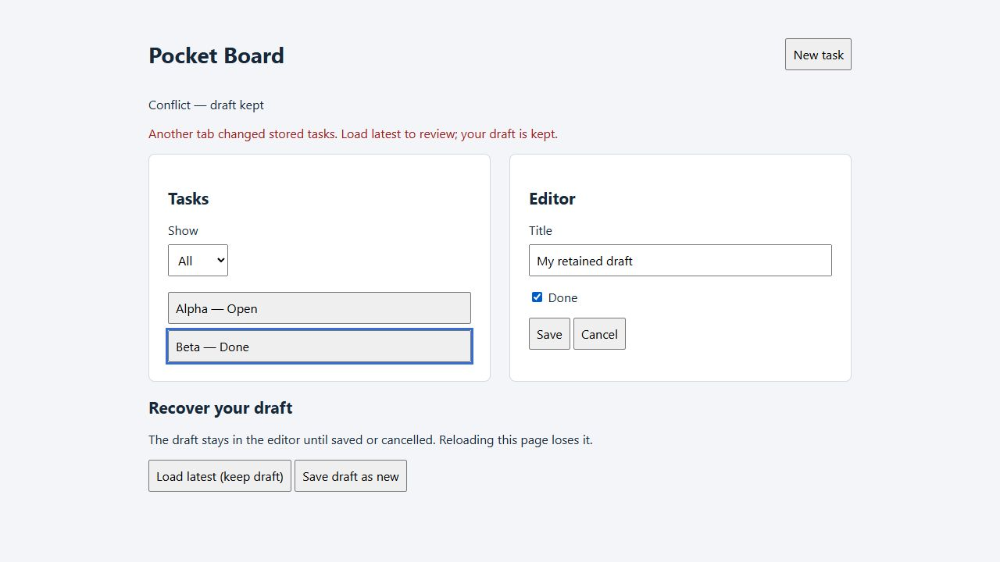

# Worked browser improvement: honest saves and conflict recovery

Pocket Board is a synthetic MIT teaching fixture with local data only. This example
keeps the historical [reference](reference/app.js) and [parity reconstruction](parity/app.js)
byte-identical and adds a separate [improved candidate](improved/app.js). It teaches
how an explicitly approved improvement differs from compatibility reconstruction.
The [acceptance profile](ACCEPTANCE.md) was frozen before improved implementation.
See [observed results and limitations](OBSERVED.md) and [captured states](observed.json).
Sources and expectations were visible to the implementing/reviewing agent. This
is not a blind benchmark, independent review or reliability certification.

| Trigger | Reference and parity | Improved candidate |
| --- | --- | --- |
| Save fails after an earlier success | Old `Saved` status remains beside failure alert | `Save failed`, retained draft and prior stored bytes; retry works |
| Another tab saves first | Stale whole snapshot silently overwrites newer data | Conflict retains draft and leaves latest bytes untouched |
| Two tabs create the next ID | Both use ID 3; later write loses earlier task | Stale write blocked; explicit copy uses latest available ID |
| Recovery | Reload loses unsaved draft | Load latest keeps draft; save as new preserves both contributions |
| Locking unavailable | No coordination | Writes fail closed; draft stays in memory |



## Run locally

Use existing Node.js 20+; no packages, model API, extra agent or remote service:

```text
node --test tests/browser-improvement.test.mjs
node evals/browser-improvement/server.mjs
```

The server binds only loopback and serves explicit fixture routes. Use a disposable
browser context with no real tasks at these origins. Reference, parity and improved
use ports 41774, 41775 and 41776 respectively. Open `/setup.html`, click **Apply store**,
then open `/index.html`. The setup textarea accepts raw synthetic values; **Read
store** exposes exact bytes. Two tabs at one port deliberately share the store.
Different ports isolate targets. Reset and verify seed before each independent
sequence; retain state within deliberate persistence/concurrency sequences.

`/fixture.html` adds visible controls for a single pre-native-write rejection,
holding/releasing the next Web Lock callback and refusing lock requests. Plain
`/index.html` loads none of this instrumentation. A hold extends the real browser
lock callback before the application's read/check/write; a second request queues
while it is held. Release it through the fixture button. This demonstrates an
overlap without pretending that sequential clicks alone establish a race test.

[browser-check.mjs](browser-check.mjs) exports `runBrowserChecks(createTab, record,
{targets})`. Supply a supported browser adapter returning tabs with the documented
Playwright-style UI actions, `goto`, `reload`, `close`, `domSnapshot` and read-only
DOM `evaluate`. Run one target per bounded tool call; `record` persists partial
captures/errors. It neither installs nor starts a browser. The `afterSeed` hook
can challenge the actual action path with a hidden Save click; that run must reject
and remains separate from successful results. [recovery-check.mjs](recovery-check.mjs)
exports the supplemental copy-overlap/malformed recovery replay.

Recompute a complete three-target capture set with `auditCaptures(report)` from
[profile.mjs](profile.mjs). It requires 75 unique checkpoints, checks expected fields
and exact stored bytes against its source-controlled oracle, and rejects recorded
errors, omissions and duplicates. Capture-supplied expectations/pass flags are not
trusted. Additional recovery checks have their own executable assertions. Preserve
action failures and source/capture identities; partial records are not completed runs.

## Design and scope

The improved candidate requests the exclusive `pocket-board-v1:write` Web Lock,
reads storage inside it, compares exact baseline bytes, and writes only if unchanged.
Recovery append reads/validates latest data and allocates IDs inside the same lock.
While waiting, controls are disabled to keep the submitted draft stable. Load latest
does not authorize an overwrite: ordinary Save remains blocked until explicit copy
or Cancel/reopen. This conservative policy also conflicts on unrelated edits; it
does not merge records automatically. Cancel refreshes latest rows and closes the
editor. Normal unchanged malformed startup data retains the original explicit-save
repair behavior; malformed latest data during copy recovery is rejected.

The [Web Locks specification](https://www.w3.org/TR/web-locks/) describes cooperative
coordination within a storage bucket. This design assumes all writers share that
lock and bucket. Original/external writers ignore it and can race. Revision checks
alone do not serialize writes; same-byte ABA changes remain undetected. Unsupported
or refused locking blocks writes. Drafts are volatile and disappear on reload.
`Saved` means the synchronous storage API accepted the write; crash/power-loss
durability, browser restart, real storage denial and cross-browser/model/host
behavior remain unverified. No backend, new dependency or model-specific behavior
is part of the candidate.
