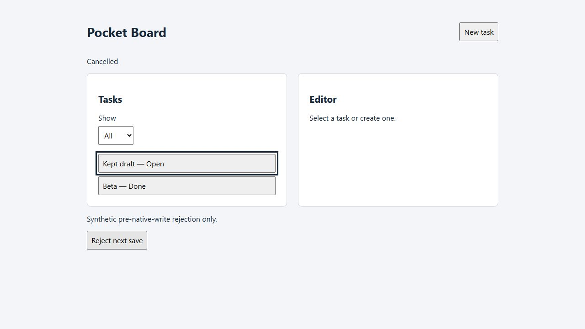

# Worked interface accessibility slice

Pocket Board is the existing owned MIT synthetic teaching interface. This
[candidate](app.js) starts from the frozen [historical improved fixture](../browser-improvement/improved/app.js)
in v1.3.29 and addresses keyboard focus and error association. All historical
reference/parity/improved bytes and their expectations remain unchanged.
See the pre-edit [acceptance profile](ACCEPTANCE.md), [observed results](OBSERVED.md)
and [conditional skill guidance](../../skills/rea-reconstruction-companion/references/interface-accessibility.md).

| Dimension | Preserved or deliberately changed |
| --- | --- |
| Functional/storage | Same schema, trimming, IDs, filtering, save/error strings, safe lock/conflict policy and draft retention. |
| Interaction/accessibility | Proposed Cancel return by stable task id, fallback when filtered away, recovery of focus lost while controls are disabled, invalid state/error association and correction clearing. |
| Visual | Same layout and visible labels; explicit keyboard-focus outline distinct from selected-row styling. No full visual-parity or measured contrast claim. |
| Evidence | Actual selected keyboard/DOM/AX/screenshots separately from deterministic application doubles. No spoken-announcement or independent-user evidence. |



## Run without new dependencies

Use existing Node.js 20+ from the repository root:

```text
node --test tests/interface-accessibility.test.mjs
node evals/interface-accessibility/server.mjs
```

The server binds loopback only, with explicit routes and no external assets.
Baseline port 41780 and candidate port 41781 isolate disposable localStorage
(`pocket-board-v1`). In an existing browser open `/setup.html`, click **Apply store**,
then open `/fixture.html` at the same port. Reset before each independent run and
confirm Alpha/Open and Beta/Done. `/index.html` excludes instrumentation. Ctrl+C
stops the server; no process restart or data durability is claimed.

The fixture's **Reject next save** injects one rejection before the native storage
write. It is not real browser quota/permission denial. The setup's **Read store**
exposes the exact disposable bytes; do not use these origins with real tasks.

[browser-check.mjs](browser-check.mjs) exports `runBrowserChecks(createTab, record)`.
Supply an existing supported native-key browser adapter: `pressKey(null,key)`
without refocusing a chosen control, `typeText(null,text)`, AX observation,
read-only DOM evaluation, setup/fault UI locators and tab close. `createTab(url)`
opens a disposable tab; `record(report)` persists partial evidence. No browser
is installed or launched by the module. It deliberately requires actual native
Tab/Shift+Tab/Enter/Space inputs; a click-only or DOM-key-event substitute cannot
establish those results. Unsupported adapter actions leave the run incomplete.

The replay opens Alpha, toggles/cancels, rejects blank Title, corrects/saves,
tests failure after success and retry, then filters away the saved task and
checks fallback plus New task/Cancel. Data/fault preparation clicks and filter
selection are labeled; keyboard checks use actual keys. Names/error relationships
come from rendered inspection, not a speech engine. `auditCaptures(report)`
requires the exact 22 checkpoints against [literal expectations](profile.mjs),
rejects errors, duplicates, omissions and matching self-approved wrong values.

The [deterministic double](model-harness.mjs) executes the candidate script and
models disabling/hiding/rerender focus transitions for regressions and five
targeted defects. It is not a browser, tab-order engine, real Web Lock, AX tree
or screen reader. The historical browser-improvement suite separately preserves
the earlier storage/conflict coverage; new focus behavior is not inferred from it.

## Bounded results and remaining checks

Use [OBSERVED.md](OBSERVED.md) for actual methods/coverage. To check announcements
with a user's already available browser and screen reader, repeat open → blank
submit → correction → save → injected failure → retry → Cancel. Record the
actual spoken label, invalid/error description and status transitions, focus and
any duplicate/noisy announcements. Review another device/browser only if required
for the user's target. These checks remain unrun here; no assistive/auditor
software installation, automation bypass or universal conformance claim follows.
