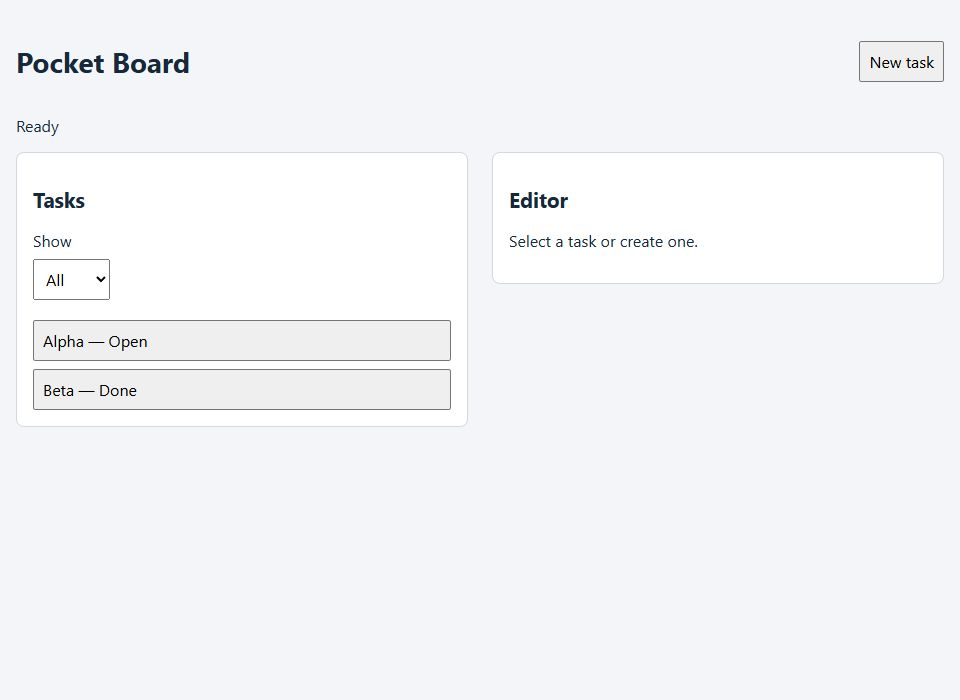
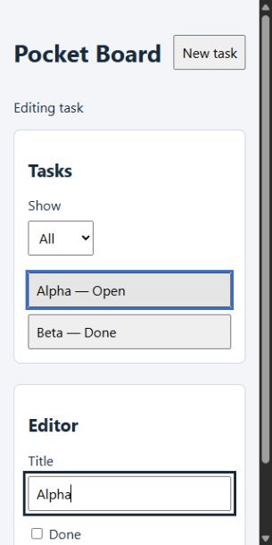
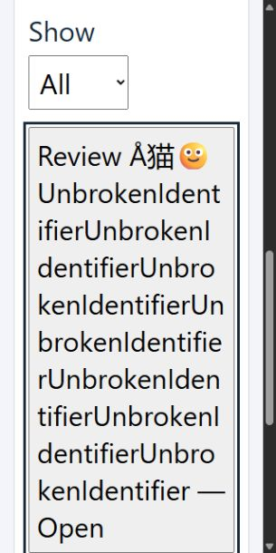
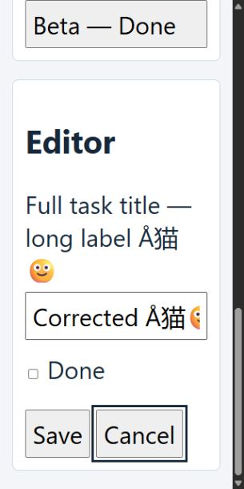
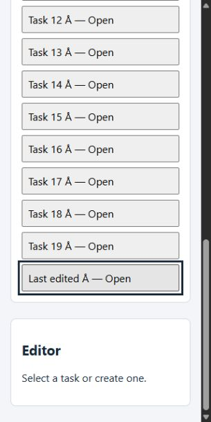
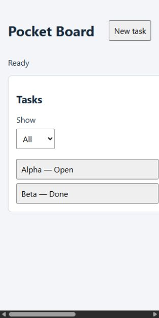
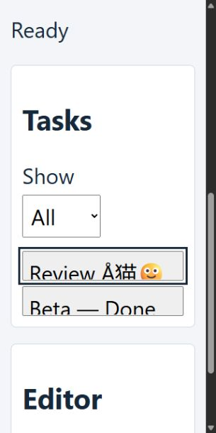
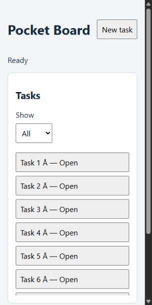

# Responsive Pocket Board worked example

This separate layout adapts the [accessibility fixture](../interface-accessibility/README.md)
without modifying its historical HTML, app or evidence. It serves the same app
on its own disposable origin. Layout and usability expectations in
[CONTRACT.md](CONTRACT.md) and [expectations.json](expectations.json) were frozen
before browser execution; [identity.json](identity.json) binds their bytes and
the reused app. Same-author, source-exposed and proposed usability expectations;
no blind model evaluation or original-target parity claim.

Run `node evals/responsive-layouts/server.mjs`, then open the printed loopback URL
in an existing supported browser. This sets synthetic storage only on that
origin. The finite `case` query is ordinary, narrow, long, empty or volume;
`variant` is candidate, fixed-columns, clipped-text or clipped-list. Reloading
normally reseeds; `keep=1` preserves that disposable store for reopen checks.
Stop the server with Ctrl+C. No dependency installation or external requests.

## Performed matrix and interactions

Observed 2026-10-21 through supported Codex in-app browser viewport overrides,
native Tab/Return and locator preparation/clicks, with read-only DOM geometry
and screenshots. The HTTP User-Agent reported Windows 10 x64 / Chrome155.0.0.0;
the reduced UA does not disclose an exact Chromium patch. Device pixel ratio1.
Viewport sizes are CSS pixels including the scrollbar; screenshots show the
content area, which can be narrower. The capture API returned JPEGs at960×700
for ordinary,305×610 for typical narrow captures, and313×625 for the horizontal
overflow defect. Their output sizing differs from the measured CSS viewport;
do not infer physical device dimensions or browser zoom from those pixels.
The report records each image's dimensions separately. Native zoom was not exercised. The long
case changes the body font from16px to32px and controls inherit it: authored
200% font-size simulation, not browser/OS zoom.

| Case | CSS viewport / font | Actual selected result |
| --- | --- | --- |
| Ordinary → narrow → back | 960×700 →320×640 →960×700 /16px | Two columns become one; open Alpha draft retained; Tab to Cancel then Return restores task-1 focus. |
| Long content | 320×640 /32px | Long heading/action/field labels and Å猫🙂 plus an unbroken identifier wrap. Blank title gives invalid state and correction text; correction clears it. Native Tab reaches Done/Save/Cancel, Return saves and cancels with row focus. A single-line input scrolls its value intentionally. |
| Empty | 320×640 /16px | No tasks; New task opens Title by keyboard. |
| Twenty rows | 320×640 /16px | Last row clicked after automatic document scroll; edit, Tab/Return Save/Cancel and focused last row remain visible. Navigation with keep=1 retains Last edited Å. |

There is no dialog, sticky overlay or nested scroll owner in this selected
fixture. Document scrolling is intentional; below-fold controls are not all
visible at once. Center hit tests, bounds and focus outlines supplement the
recorded interactions and screenshots; they do not prove all pixels are
unobscured. Locator clicks can scroll to prepare a case and do not prove a
whole-list keyboard navigation path. Error feedback is the retained app's short
literal error, not every long translated message.

## Deliberate defects and limits

All three CSS variants passed the ordinary960×700 two-row view before a selected
extreme produced an actual layout assertion difference:

- fixed-columns at320px: two columns remain and document horizontal overflow.
- clipped-text with long32px content: row scroll height exceeds its visible box.
- clipped-list with20rows: late rows extend beyond a hidden-overflow ancestor.

[observed.json](observed.json) retains12ordered captures, selected control checks,
three ordinary/extreme defect pairs and action results. [observed-identity.json](observed-identity.json)
binds that report, fixture/checker and screenshots. The finite consistency audit
in [check.mjs](check.mjs) rejects omissions, wrong geometry/focus/content and
action errors; it cannot authenticate a report or certify arbitrary prose.
`node --test tests/responsive-layouts.test.mjs` rechecks retained evidence and
challenged reports, not a new rendered run. `inspect`, `inspectControl` and
`layoutFailures` are reusable with a supported tab; a double remains a double.

Native browser zoom, OS/text-only scaling, text spacing, real touch devices,
other engines, screen-reader announcements, full localization/bidi and large-data
performance remain unrun. No blanket accessibility or WCAG conformance claim.
Exact source identities and failed setup attempts remain in private task evidence.
Repeat affected rendered/interaction cases after relevant source, content, font,
viewport or browser changes; do not relabel these retained captures as a fresh run.
